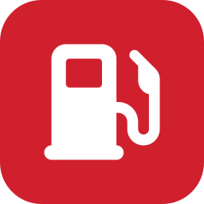
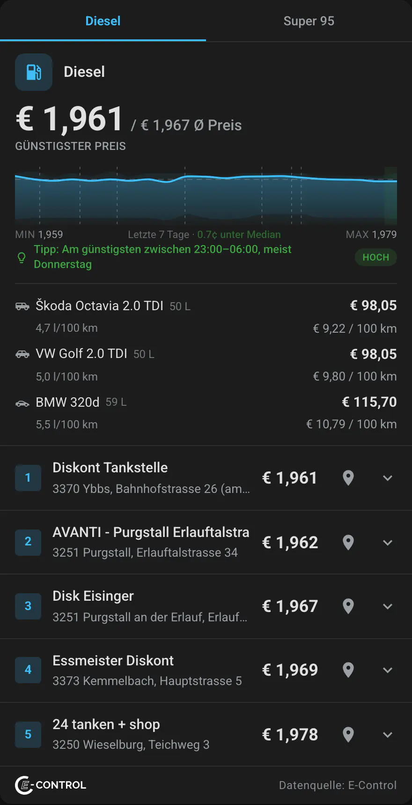
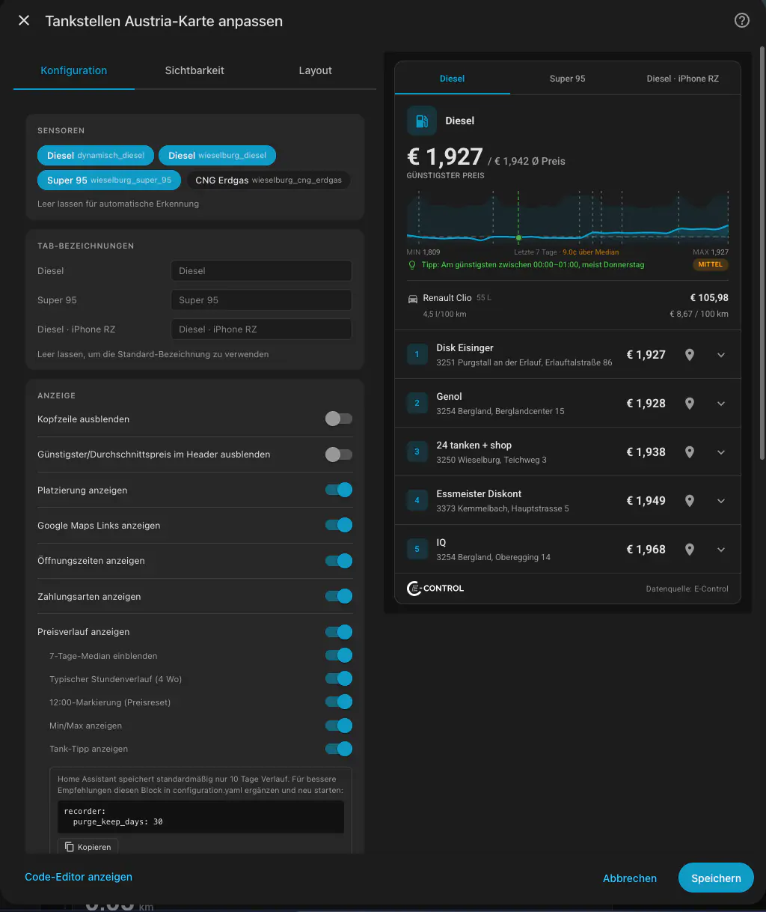
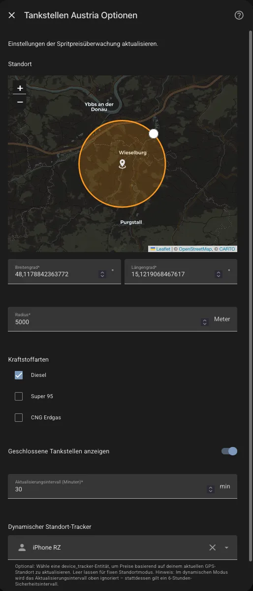

# <sub><sub></sub></sub> Tankstellen Austria

[](https://www.home-assistant.io/integrations/marketplace/)
[](https://www.home-assistant.io/)
[](https://github.com/rolandzeiner/tankstellen-austria/releases)
[](https://opensource.org/licenses/MIT)
[](https://en.wikipedia.org/wiki/Vibe_coding)
[](https://demo.rolandzeiner.at/#tankstellen)

Austrian fuel prices in Home Assistant, from E-Control's [Spritpreisrechner](https://www.e-control.at/spritpreisrechner). You get the five cheapest stations near you for Diesel, Super 95 and CNG, as sensors and on a card.

## Screenshots

<table>
  <tr>
    <td align="center"></td>
    <td align="center"></td>
    <td align="center"></td>
  </tr>
  <tr>
    <td align="center"><em>Lovelace card</em></td>
    <td align="center"><em>Card editor</em></td>
    <td align="center"><em>Config flow</em></td>
  </tr>
</table>

## Features

- One price sensor per fuel type, carrying the five cheapest nearby stations with opening hours, payment methods and distance.
- A card with a tab per fuel type, brand-coloured station details, navigation links, a seven-day chart and a visual editor, in German and English.
- A best-time-to-refuel tip worked out from up to four weeks of your price history, marked on the chart and available as sensors for automations.
- Prices that follow your phone or car as you drive, with fixed and moving locations side by side.
- Show only the stations that take your card, or highlight them, and see which stations are closed or closing soon.
- Fill-up cost per car at the cheapest station, with the cost per 100 km.
- Optional long-term statistics, so price charts can span months instead of days.
- A Repairs notice that tells you when E-Control's service is down, so you know your setup is fine.

## Requirements

- Home Assistant **2026.3.0** or newer.
- No account and no API key.

## Installation

### Marketplace (recommended)

The Marketplace is HACS, built into Home Assistant since 2026.11.

1. In Home Assistant, go to **Settings → Marketplace** and search for **Tankstellen Austria**.
2. Select it, then select **Install**. The setup starts right away, no restart needed.

[](https://my.home-assistant.io/redirect/hacs_repository/?owner=rolandzeiner&repository=tankstellen-austria&category=integration)

On Home Assistant older than 2026.11, use HACS instead: search for **Tankstellen Austria**, select **Download**, then restart Home Assistant.

### Manual

1. Download `tankstellen_austria.zip` from the [latest release](https://github.com/rolandzeiner/tankstellen-austria/releases/latest).
2. Unzip it into `config/custom_components/tankstellen_austria/`.
3. Restart Home Assistant.

## Setup

[](https://my.home-assistant.io/redirect/config_flow_start/?domain=tankstellen_austria)

1. Go to **Settings → Devices & services → Add integration** and select **Tankstellen Austria**.
2. Pick your location on the map and the fuel types you want.
3. To have prices follow you, select a tracker under **Dynamic location tracker**. Leave it empty for a fixed location.
4. Select **Submit**. The integration checks that E-Control answers, then creates one sensor per fuel type.

Add one entry per place you care about, such as home, work and your phone.

| Field | Default | Description |
|---|---|---|
| **Name** | Tankstellen | Device name; the entity IDs are built from it. |
| **Location** | your home location | Where to search from. Ignored while a tracker is set. |
| **Fuel types** | Diesel, Super 95 | Any of Diesel, Super 95 and CNG Erdgas. At least one. |
| **Include closed stations** | on | Also list stations that are closed right now. |
| **Update interval (minutes)** | 30 | 10 to 720, in steps of 5. Ignored in dynamic mode. |
| **Long-term statistics** | off | Record hourly minimum, maximum and average prices (see *Entities*). |
| **Dynamic location tracker** | empty | A `device_tracker` whose position replaces the fixed location (see *Data updates*). |

## Options

**Settings → Devices & services → Tankstellen Austria → Configure** opens the same fields as setup, without **Name**. ⋮ → **Reconfigure** offers the same form. Saving reloads the entry; entity IDs and history stay.

| Field | What changes |
|---|---|
| **Location** | The search point for a fixed entry. |
| **Fuel types** | A new fuel type gets its sensor. A dropped one leaves its sensor unavailable until you delete it on the entity's settings page. |
| **Include closed stations** | Which stations the next update lists. |
| **Update interval (minutes)** | The cadence, from the reload on. |
| **Long-term statistics** | Turning it off leaves the recorded statistics in place (see *Entities*). |
| **Dynamic location tracker** | Switches the entry between fixed and dynamic mode. |

## Entities

### Sensors

One sensor per fuel type you selected. The entry name is the device name, so an entry named "Home" with all three fuel types gives `sensor.home_diesel`, `sensor.home_super_95` and `sensor.home_cng_erdgas`.

| Entity | State | Unit |
|---|---|---|
| `sensor.<entry name>_<fuel type>` | Cheapest price among the listed stations | €/l |

| Attribute | Description |
|---|---|
| `fuel_type` | `DIE`, `SUP` or `GAS` |
| `fuel_type_name` | Diesel, Super 95 or CNG Erdgas |
| `station_count` | Number of stations in `stations` (at most 5) |
| `average_price` | Average price of the listed stations, not a regional average |
| `stations` | One entry per station, cheapest first: `id`, `name`, `price`, `open`, `location` (address and coordinates), `distance_m` (metres, as the crow flies), `opening_hours`, `payment_methods`. Not stored in the recorder history. |
| `dynamic_mode` | `true` when the entry follows a tracker |
| `dynamic_tracker_label` | Friendly name of the tracker, in dynamic mode only. The tracker's entity ID is not exposed. |
| `attribution` | See *Attribution* |

`payment_methods` holds `cash`, `debit_card` and `credit_card` as booleans, and `others` as a list of the strings E-Control sends, such as `Austrocard` or `UTA`.

### Cheap window

Two more entities per fuel type carry the card's refuel tip, so an automation can use it. They compute the same window from the same 28 days of history, so the card and the entities agree.

| Entity | State |
|---|---|
| `binary_sensor.<entry name>_<fuel type>_cheap_window` | `on` during the cheapest hours of the day |
| `sensor.<entry name>_<fuel type>_next_cheap_window` | When the window opens next (timestamp) |

Both are `unknown` until there are 7 days of history, and `unavailable` when the recorder isn't running. Neither exists in dynamic mode, where the card hides its tip too. The binary sensor's attributes:

| Attribute | Description |
|---|---|
| `start_hour`, `end_hour` | The window in local hours. `end_hour` is exclusive and can be smaller than `start_hour` when the window crosses midnight. |
| `weekday` | The cheapest weekday (`monday` … `sunday`) when it stands out, otherwise `null` |
| `confidence` | `high`, `medium` or `low`, as on the card's badge |
| `confidence_score`, `span_days`, `coverage_pct`, `gap_cents` | What the confidence is made of (see *How the window is computed*). Not stored in the recorder history. |

### Long-term statistics

Off by default. Without it, the sensors keep only state history, which the recorder purges after `purge_keep_days` (10 by default). With it on, Home Assistant also records hourly minimum, maximum and average prices, and those survive the purge. The refuel tip on the card and the *Cheap window* entities use those hourly averages for the days the recorder has purged, so they see four weeks without a longer `purge_keep_days`.

Home Assistant pairs the `monetary` device class only with `state_class: total`, which makes no sense for a unit price. With statistics on, the sensors therefore drop `device_class: monetary` and use `state_class: measurement`. Entity IDs, unique IDs, attributes and the card stay the same.

When you turn it off again, the recorded statistics stay, and Home Assistant raises a repair saying the sensor *"no longer has a state class"*. It links to **Developer tools → Statistics**, where you can delete them without touching the sensor.

## Cards

Home Assistant loads the card for you on dashboards in storage mode, the default. For a YAML dashboard, add the resource yourself:

| URL | Type |
|---|---|
| `/tankstellen-austria/tankstellen-austria-card.js` | JavaScript module |

The minimal card finds every Tankstellen Austria sensor on its own:

```yaml
type: custom:tankstellen-austria-card
```

The visual editor covers every option. Options sit in groups, by the part of the card they change; the defaults below apply when you leave a key out. The card picker starts you with `stations.distance` on and `stations.payment_mode: highlight`.

```yaml
type: custom:tankstellen-austria-card
entities:
  - sensor.home_diesel
  - sensor.home_super_95
stations:
  count: 3
  sort: distance
chart:
  median_line: true
cars:
  show: true
  items:
    - name: Golf
      fuel_type: DIE
      tank_size: 50
      consumption: 5.8
```

| Option | Default | Description |
|---|---|---|
| `entities` | all sensors | List of this integration's price sensors, one tab each |
| `language` | Home Assistant's | `de` or `en` |
| `tab_labels` | `{}` | Your own tab label per entity |

**`stations`**

| Option | Default | Description |
|---|---|---|
| `count` | `5` | Stations to list, 0 to 5. `0` hides the list. |
| `index` | `true` | Rank number per station. In the editor, switching it on turns `brand` off |
| `brand` | `false` | The station's brand initials and colour in the tile, in place of the rank; works with `index` off, and the editor turns `index` off when you switch it on (OMV, Avanti, BP, Shell, Eni, JET, Turmöl, AVIA, SOCAR, Lagerhaus/Genol; other stations get their initials on a grey tile). Colours only, no logos. |
| `tile_shape` | `square` | The rank tile's shape: `square` (rounded corners) or `circle`; applies to the rank and the brand alike |
| `map_links` | `true` | Navigation link per station |
| `map_provider` | `auto` | `auto` (Apple Maps on iOS, the app chooser on Android, Google Maps elsewhere), `google` or `apple` |
| `distance` | `false` | Distance under each station's map pin |
| `sort` | `price` | `price` lists the cheapest first, `distance` the nearest |
| `opening_hours` | `true` | Opening hours in the station details |
| `payment_methods` | `true` | Payment methods in the station details |
| `payment_filter` | `[]` | `cash`, `debit_card`, `credit_card`, or any string E-Control sends, such as `Routex`, `UTA`, `DKV` |
| `payment_mode` | `filter` | `filter` hides the stations without a match, `highlight` shows them and highlights the matches |

**`header`**, **`chart`**, **`cars`** and **`footer`**

| Option | Default | Description |
|---|---|---|
| `header.show` | `true` | The header |
| `header.price` | `true` | The cheapest and average price in the header |
| `chart.show` | `true` | Seven-day price chart |
| `chart.min_max` | `true` | Minimum and maximum on the chart |
| `chart.median_line` | `false` | Seven-day median line |
| `chart.hour_envelope` | `false` | Typical price range per hour of day, over four weeks |
| `chart.noon_markers` | `false` | Markers at the daily 12:00 price reset |
| `chart.best_refuel` | `true` | Refuel tip and its band on the chart |
| `cars.show` | `false` | Fill-up cost per car |
| `cars.fill_up` / `cars.consumption` | `true` / `true` | Fill-up cost and cost per 100 km rows |
| `cars.items` | `[]` | Each car: `name`, `fuel_type` (`DIE`, `SUP` or `GAS`), `tank_size` (1 to 200 l), optional `consumption` (l/100 km) and `icon` |
| `footer.show` | `true` | The E-Control footer |
| `footer.adaptive_logo` | `false` | Show the E-Control logo as a silhouette in your theme's colour |

<details>
<summary>Cards set up before v2.0.0</summary>

Older cards keep working: the card reads the flat options of v1 (`max_stations`, `show_index`, `hide_header`, `cars` as a list, …) as their grouped counterparts, and the visual editor saves them in the new shape the next time you change something. `hide_header`, `hide_header_price` and `hide_attribution` turn into `header.show`, `header.price` and `footer.show` with the opposite value; `sort_by_distance` and `payment_highlight_mode` into `stations.sort` and `stations.payment_mode`. Where a card has both, the grouped option wins.

</details>

### Best refuel time

The card, and the integration for the *Cheap window* entities, read up to four weeks of the sensor's history (again every 30 minutes) and look for the run of hours that is cheapest compared with the rest of each week. The window is as long as the data says: one hour when one hour stands out, most of the day when prices only jump at noon. It is drawn as a green band on the chart, a weekday is added when that signal is strong too, and a High, Medium or Low confidence badge explains itself on hover.

Home Assistant keeps 10 days of history by default, so confidence stays low until you keep more, or turn on *Long-term statistics* (the hourly averages fill the purged days):

```yaml
# configuration.yaml
recorder:
  purge_keep_days: 30
```

The tip follows the cheapest nearby station at each moment, not any one station's pattern. "21:00–03:00" can mean one station drops in the evening and another is cheap at midnight.

<details>
<summary>How the window is computed</summary>

Austrian law lets stations raise prices once a day at 12:00 and lower them at any time. The sensor is the cheapest of up to five stations, so its history mixes every station's noon rise, every evening drop and the cheapest station changing. The card pulls the time-of-day signal out in six steps:

1. **Duration-weighted chunks.** Each price interval is split at every hour boundary, and each hour-of-day and weekday bucket is credited by the time the price was active in it. A rise at 12:14 counts for 46 minutes of the 12:00 hour, not all of it.
2. **Weekly clipping.** Values outside the 5th to 95th percentile of each Monday-aligned week are clipped, which removes glitches and keeps the noon spike from skewing the weekly mean.
3. **Weekly normalisation.** Each chunk becomes its price minus that week's mean, so the weekly low wins whatever the price level.
4. **Separate buckets.** The differences go into 24 hour-of-day and 7 weekday buckets, kept apart.
5. **Weighted median per bucket.** Weights are duration times recency, with a half-life of 14 days.
6. **Window growth.** Starting from the bucket with the lowest median, the window takes in every neighbouring hour within about 0.5 cent per litre of it, with no length cap.

Confidence averages three parts: how much of the 28 days is covered, whether each hour has at least three chunks, and how far the cheapest bucket sits below the others, against a 1.5 cent reference. The High, Medium and Low thresholds were tuned on real Austrian price histories.

</details>

## Data updates

A fixed entry polls E-Control at its **Update interval (minutes)**, every 30 minutes by default. The form doesn't go below 10 minutes, the informal limit for this API. Each update makes one request per fuel type.

- **Around noon** (about 12:05 to 12:07 Vienna time) E-Control sometimes answers with no stations while it refreshes. The sensors keep their values and the integration tries once more after 10 minutes.
- **When one fuel type fails**, the others update and the failed one keeps its last value. The entry goes unavailable only when every fuel type fails.
- **When updates keep failing**, the interval doubles from the second failure in a row, up to 12 hours, and returns to normal after the next success. After at least two failures over 10 minutes or more, a Repairs issue says E-Control isn't sending prices, and it clears itself once prices return.
- **During E-Control maintenance** the entries go unavailable and the card says why. One check every 10 minutes serves all entries, and prices return with the next update once the service is back.

### Dynamic mode

With a **Dynamic location tracker** set, the entry searches around the tracker's position instead of the fixed location. An update runs when the tracker moves, if all of these allow it:

| Guard | Value | Purpose |
|---|---|---|
| Distance | 1.5 km | Ignores parking and walking drift |
| Per-entry cooldown | 10 minutes | At most one update per entry in that time |
| Cooldown across all entries | 5 minutes | Spaces out several dynamic entries |
| Safety-net poll | 6 hours | Keeps data fresh when the tracker stops reporting; replaces the update interval |

When the tracker has no position, the entry searches around your Home Assistant home location and raises the Repairs issue **Location tracker unavailable**. Outside Austria E-Control returns no stations, so the sensors keep their last values.

On the card, a dynamic tab is labelled with the tracker, such as `Diesel · iPhone`. The header shows when prices were last updated instead of the cheapest price, and a refresh button fetches new prices at once; it pauses for 2 minutes after each press. The price chart and refuel tip are hidden, since history from changing places doesn't compare.

## Examples

- Get a notification when the cheapest Diesel drops below your target.
- Follow prices on a road trip with a dynamic entry on your phone.
- Compare home and work with two fixed entries, side by side on one card.
- Track a favourite station with a template sensor, as below.

**Notify when the cheapest Diesel drops below 1.50 €/l:**

```yaml
alias: "Notify on cheap Diesel"
triggers:
  - trigger: numeric_state
    entity_id: sensor.home_diesel
    below: 1.50
actions:
  - action: notify.mobile_app_phone
    data:
      title: "Cheap Diesel nearby"
      message: >
        {{ state_attr('sensor.home_diesel', 'stations')[0].name }}
        — {{ states('sensor.home_diesel') }} €/l
```

<details>
<summary>Track the price of one favourite station</summary>

Template sensors go into `configuration.yaml` under a top-level `template:` key; restart after editing.

```yaml
template:
  - sensor:
      - name: "Favourite station Diesel"
        unit_of_measurement: "€/l"
        state: >
          {{ state_attr('sensor.home_diesel', 'stations')
             | selectattr('name', 'search', 'Essmeister')
             | map(attribute='price') | list | first | default(none) }}
```

The station is only in `stations` while it is among the five cheapest, so the sensor is `unavailable` for the updates where it isn't. Keep `| default(none)`: returning the string `'unavailable'` fails the numeric unit check.

The same works without YAML: go to **Settings → Devices & services → Helpers → Create helper → Template → Template a sensor**, paste the state expression above, and set **Unit of measurement** to `€/l`. Set **State class** to `measurement` if you want history graphs. No restart needed.

</details>

## Known limitations

- Stations in Austria only.
- At most five stations per fuel type, and only stations that report a price.
- The refuel tip needs at least 7 days of history and gets better up to 28. It works in whole hours and doesn't treat public holidays separately.
- Long-term statistics record whatever the entry watches. In dynamic mode that area moves with you, so the series mixes places.

## Troubleshooting

- **"Cannot connect to the E-Control API" during setup.** Usually a short network problem; try again. Check that your Home Assistant host can reach `https://api.e-control.at`.
- **Sensors unavailable shortly after 12:00.** E-Control's daily refresh; see *Data updates*.
- **"E-Control is down for maintenance".** Nothing to fix on your side. The integration keeps checking and recovers on its own.
- **The card says *Can't reach E-Control*.** The last update failed, or none has worked since Home Assistant started. If **Settings → Repairs** shows *E-Control isn't sending fuel prices*, the fault is on E-Control's side and prices return on their own. If not, check that your host can reach the internet.
- **Repairs shows *Location tracker unavailable*.** The tracker is gone or has no position. Restore it, or use ⋮ → **Reconfigure** to pick another tracker or none.
- **The card is missing from the card picker.** On a YAML dashboard, add the resource yourself; see *Cards*.
- **Diagnostics for a bug report.** Go to **Settings → Devices & services → Tankstellen Austria**, then ⋮ → **Download diagnostics**. Coordinates and the tracker are redacted.
- **Debug logging:**

  ```yaml
  # configuration.yaml
  logger:
    default: info
    logs:
      custom_components.tankstellen_austria: debug
  ```

## Removal

1. Go to **Settings → Devices & services → Tankstellen Austria** and, on each entry, select ⋮ → **Delete**. Deleting the last entry also removes the card's dashboard resource.
2. In **Settings → Marketplace**, open **Tankstellen Austria**, then ⋮ → **Uninstall**. If an entry is still set up, the Marketplace offers **Delete and uninstall**, and a repair asks you to restart.
3. For a manual install, delete `config/custom_components/tankstellen_austria/` and restart instead.

Recorded long-term statistics stay until you delete them in **Developer tools → Statistics**. On a YAML dashboard, remove the card resource yourself.

## Attribution

Every sensor, every diagnostics download and the card footer carry this line, the `ATTRIBUTION` constant in `const.py`:

> Datenquelle: E-Control

In full: Energie-Control Austria für die Regulierung der Elektrizitäts-, Gas- und Wasserstoffwirtschaft (E-Control). The prices come from the [Spritpreisrechner](https://www.e-control.at/spritpreisrechner) through its public API ([API documentation](https://api.e-control.at/sprit/1.0/doc/index.html?url=https%3A%2F%2Fapi.e-control.at%2Fsprit%2F1.0%2Fapi-docs%3Fgroup%3Dpublic-api)). E-Control publishes no separate terms of use for this API. If you build your own card or dashboard on the data, keep the line visible.

Icon: Font Awesome Free, CC BY 4.0.

## License

MIT, see [LICENSE](https://github.com/rolandzeiner/tankstellen-austria/blob/main/LICENSE).

Development setup and the verification gate are in [CONTRIBUTING.md](https://github.com/rolandzeiner/tankstellen-austria/blob/main/CONTRIBUTING.md).

## Disclaimer

This integration is not affiliated with or endorsed by E-Control. Fuel prices come from E-Control's [Spritpreisrechner](https://www.e-control.at/spritpreisrechner). **The price shown at the pump is the one that counts.** The developer assumes no liability for the accuracy, completeness or timeliness of the displayed data. Use at your own risk.

---

Diese Integration steht in keiner Verbindung zur E-Control und wird von ihr nicht unterstützt. Die Spritpreise stammen vom [Spritpreisrechner](https://www.e-control.at/spritpreisrechner) der E-Control. **Es gilt immer der Preis an der Zapfsäule.** Für die Richtigkeit, Vollständigkeit und Aktualität der angezeigten Daten wird keine Haftung übernommen. Nutzung auf eigene Verantwortung.
